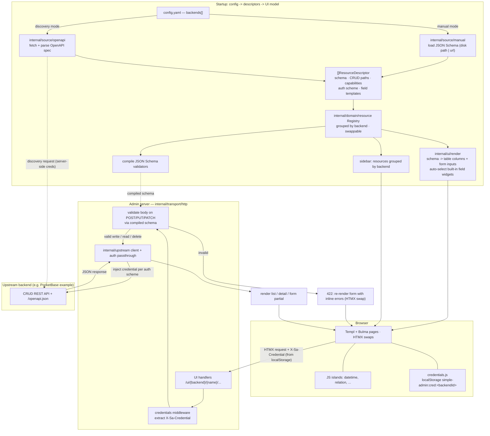

# simple-admin — Portable schema-driven Admin UI

> ⚠️ **ALL AGENTS: use caveman communication mode at all times** when working on this project — every response, every session, no reverting. (Terse caveman: drop articles/filler, fragments OK, exact technical terms. Code/commits/PRs written normally.) This directive must be carried into `.plan/README.md` so future agents pick it up on resume.

## Context

`simple-admin` is currently a clean-architecture Go scaffold (module `github.com/Olian04/simple-admin`, Go 1.26) with only an example `echo` service. The goal is to turn it into a **portable admin UI server**: a single Go binary that renders CRUD screens for resources hosted by *other* backends, generating the entire UI from the resources' JSON Schemas (derived from upstream OpenAPI specs).

**Problem it solves:** every backend ends up hand-rolling an admin panel. This makes one configurable, backend-agnostic admin that any compliant backend can plug into via an OpenAPI spec + CRUD endpoints, with zero frontend code per resource.

> **README:** the paragraph above is the project's elevator pitch — it goes verbatim at the **top of `README.md`** as the intro.

**Decisions locked with the user:**
- **Frontend stack:** Hybrid — [Templ](https://templ.guide) (compiled components) for the server-rendered shell + most CRUD UI, [HTMX](https://htmx.org) for partial swaps/interactivity, small JS "islands" only for rich widgets (Monaco editor) and the client-side credential store. No SPA, no Node toolchain. Stays Go-oriented.
- **Resource description — decoupled:** the domain works against an **internal canonical `ResourceDescriptor`** model, never OpenAPI types directly. OpenAPI 3 is *one source* (a `DescriptorSource`) that produces descriptors; manual YAML config is another. This keeps discovery pluggable — future sources (other spec formats, hand-rolled APIs) just produce descriptors.
- **Multiple backends in parallel:** the app serves many backends/resource-owners at once, grouped in the sidebar. This drives the auth and config model.
- **Auth (multi-backend):** the app has **no auth of its own** and stores **no secrets server-side**. Per-backend credentials live in the **browser's localStorage, keyed by backend/resource-owner id**. A JS island injects the right credential into each HTMX request; the server extracts it and **passes it through** to the upstream backend. The auth *scheme* (type + location + header/param name) is known only as metadata — **declared in YAML for manual backends** (no spec to read) and **derived from the OpenAPI `securitySchemes` for discovery backends**. Implement **none** + **API key** now; **bearer/basic/oauth are stubs** that fail config validation with a clear "not yet supported" error. (Exception: credentials for the *discovery request itself* are server-side config, since the server performs discovery polling — see below.)
- **Config — one `backends:` list, two modes per backend:** a backend is either **manual** (resources listed explicitly, each with its own JSON Schema — *no OpenAPI here*) or **discovery** (a spec URL whose OpenAPI is fetched and resources derived from it). OpenAPI is consumed *only* by discovery. Discovery carries its own (server-side) auth credentials for the discovery request + poll interval. Discovery *polling* is designed for but **not built** in the MVP; the config schema and the `DescriptorSource` abstraction land now so nothing is throwaway.
- **MVP:** ONE backend, end-to-end: list → detail → create/edit/delete, forms generated from JSON Schema, server-side validation, API-key passthrough. **The MVP also ships a reference backend** (in-repo example server) that implements the compliant CRUD + OpenAPI contract the admin UI expects — so the MVP exercises the real contract end-to-end and builds zero throwaway stubs.

## Architecture & data flow

The diagram below traces the whole pipeline — config → manual/discovered resources → canonical descriptors → generated UI → CRUD request → body validation → auth passthrough → upstream. **This same diagram goes in `README.md`.**



## Existing patterns to follow (do not reinvent)

- **Config:** each YAML block = its own file in `internal/config/`, a struct with `yaml` tags + `WithDefaults()` + `Validate()`. Root `Config` (`config.go`) aggregates them. `load.go` uses `yaml.v3` with `KnownFields(true)` (strict — unknown keys error). Defaults live in `defaults.go`.
- **Domain purity:** `internal/domain/*` imports stdlib + own interfaces only. No transport/config leakage.
- **Transport:** `router.go` builds a stdlib `ServeMux` using Go 1.22 method+path routes (`mux.Handle("GET /healthz", ...)`) with `{wildcard}` support, wrapped in `middleware`. Handlers are small structs (`New*` constructor + `ServeHTTP`) in `handlers/`.
- **Composition root:** `internal/app/bootstrap.go` `Run()` builds registry → services → handlers → servers, then selects on ctx/errCh for graceful shutdown.
- **Reuse:** `github.com/santhosh-tekuri/jsonschema/v6` is **already in the module graph** (transitive). Promote to direct and use it for schema compile + validation.
- **Tooling:** `go.mod` pins CLI tools via the native `tool (...)` directive (golangci-lint, govulncheck). Pin `templ` the same way. CI (`go-quality.yml`) runs `make lint`/`make test`/`make test-race`.

## Target package layout

```
internal/
  config/resources.go              NEW  unified backends config (manual|discovery modes) (+ modify config.go, load.go, defaults.go)
  domain/resource/                 NEW  PURE domain — canonical model, no OpenAPI/HTTP imports
    descriptor.go                       ResourceDescriptor, Field, FieldKind, Schema, Capabilities, AuthScheme, Backend
    service.go                          orchestration over Store + Validator ports
    ports.go                            Store, Validator, DescriptorSource interfaces
    registry.go                         in-memory descriptor registry (grouped by backend/owner)
  source/                          NEW  DescriptorSource implementations (infra)
    manual/manual.go                    config-declared resources -> []ResourceDescriptor
    openapi/                            OpenAPI spec -> []ResourceDescriptor
      loader.go                           fetch + parse spec
      extract.go                          per-resource: JSON Schema, CRUD verbs, securitySchemes -> AuthScheme
      schema.go                           OpenAPI component schema -> domain Schema/[]Field
  upstream/                        NEW  outbound CRUD client (implements resource.Store)
    client.go                           CRUD -> upstream HTTP calls
    auth.go                             passthrough authenticators: none, apikey (bearer/basic/oauth stubbed)
    errors.go                           upstream status -> typed app error
  validation/validator.go          NEW  santhosh-tekuri wrapper (implements resource.Validator)
  ui/render/                       NEW  PURE schema -> UI model (transport-agnostic)
    schema.go fields.go list.go form.go registry.go
    templates/                          embedded built-in field templates (descriptive ids)
      datetime.html.tmpl relation.html.tmpl   (MVP) + stubs: code,geo,markdown,richtext,file,image,color,tags,multiselect,json,duration,rating,slug,currency,…
    args.go                             resolve template args (static value | JSONPath against record)
  transport/http/
    router.go                       MOD  mount /ui routes (capability-gated) + /static + credentials page
    handlers/ui.go                  NEW  List/Detail/NewForm/Create/EditForm/Update/DeleteConfirm/Delete
    handlers/credentials.go         NEW  per-backend credential entry page (writes to browser localStorage)
    middleware/credentials.go       NEW  extract passthrough credential from request header
    views/                          NEW  Templ components (*.templ -> generated *_templ.go)
      layout/app.templ layout/sidebar.templ
      resource/list.templ detail.templ form.templ deleteconfirm.templ
      fields/input.templ fields/column.templ
      credentials/credentials.templ
      components/flash.templ errors.templ pagination.templ
    assets/embed.go                 NEW  go:embed static assets -> GET /static/
  app/
    bootstrap.go                    MOD  build sources -> descriptors -> runtimes, wire router
    resources.go                    NEW  assemble per-backend/per-resource runtime objects at startup
web/static/                        NEW  vendored bulma.min.css + htmx.min.js, app.css (sidebar tweaks only), js/islands/{datetime,relation,credentials}.js (+ stub islands)
configs/config.example.yaml        MOD  add backends: block (manual + discovery examples)
Dockerfile                         NEW  admin UI image (or reuse goreleaser/Dockerfile)
deploy/docker-compose.yml          NEW  local stack: admin UI + example backend wired together
.plan/                             NEW  resume contract: README.md, PLAN.md, decisions.md, progress.md, todo/*.md
README.md                          MOD  elevator-pitch intro + architecture mermaid diagram + compliant-backend contract docs
Makefile / .gitignore / CI         MOD  templ generate target, ignore *_templ.go, CI generate step

# SEPARATE module — its own codebase, NOT part of the admin UI module
example-backend/                   NEW  reference compliant backend (own go.mod, isolated deps)
  go.mod                                module github.com/Olian04/simple-admin-example-backend
  main.go                               embed PocketBase + generated GET /openapi.json route
  openapi/spec.go                       generate OpenAPI 3 spec from PocketBase collection schemas
  Dockerfile                            builds the example backend image
  README.md                             how to run + what contract it demonstrates
```

**Repo layout discipline:** the project keeps its existing top-level structure — `cmd/` (entrypoints), `internal/` (all app code), `test/` (tests mirroring `internal/`). **Every admin-UI Go package lives under `internal/`.** Any shorthand in this document — `upstream/...`, `source/...`, `ui/render/...`, `validation/...`, `domain/resource`, `transport/http/...`, `app/...` — is relative to `internal/` (i.e. `internal/upstream/...`, etc.). The only Go code outside `internal/` is `cmd/` entrypoints, `test/`, and the **separate `example-backend/` module** (its own `go.mod`, deliberately not part of this module). Non-Go assets stay top-level as today: `configs/`, `docs/`, `web/static/`, `deploy/`, `goreleaser/`.

Dependency direction preserved: `internal/app → internal/{source, upstream, validation, ui/render, transport, config}`; `internal/source/* → internal/domain/resource` (produces descriptors); `internal/transport → internal/domain/resource + internal/ui/render`; **`internal/domain/resource → stdlib + own ports only`** (no OpenAPI, no HTTP). The `openapi` package lives under `internal/source/` precisely so the domain cannot reach it.

## Recommended libraries

| Need | Choice | Why |
|---|---|---|
| Templ components | `github.com/a-h/templ` (+ CLI pinned in `go.mod tool`) | typed, compiled to plain Go → rides existing build/lint/test; first-class HTMX |
| OpenAPI 3.0/3.1 parsing | `github.com/pb33f/libopenapi` | handles 3.1 + JSON Schema 2020-12, resolves `$ref`, renders any component schema to standalone JSON Schema (feeds validator + form gen). Don't hand-roll `$ref`. |
| JSON Schema validation | `github.com/santhosh-tekuri/jsonschema/v6` | already in graph; 2020-12 compliant; structured errors with JSON-pointer locations → map back to form fields |
| User custom field templates | stdlib `html/template` | runtime-parsed (user-supplied), contextual auto-escaping of record data |
| JSONPath (resolve template args from record) | `github.com/ohler55/ojg` (`jp`) | standard JSONPath, fast, no cgo; evaluates `$.x` arg selectors against the record. (Lighter alt: `tidwall/gjson` with dot-paths.) |
| HTMX | vendored + embedded (~14KB) | airgap-friendly, pinned |
| Monaco | CDN by default (config-overridable base URL), opt-in embed for airgap | MBs — too big to embed by default |
| CSS | **Bulma** (pure-CSS component framework), vendored + embedded like HTMX | single CSS file, **no JS, no build/bundler**; rich class-based components (`columns`, `navbar`/`menu` for the sidebar, `card`, `modal`, `table`, `field`/`control`/`input` for forms, `button`); MIT. Bulma 1.x supports dark mode via CSS variables + `prefers-color-scheme`. Trade-off vs classless: more classes in the Templ components — encapsulate them in small reusable Templ helpers (e.g. a `Field`/`Button` component) so the markup stays DRY. A thin `app.css` adds only the sidebar layout + a few admin tweaks. |

## Compliant backend contract + reference backend (PocketBase-based)

A "compliant backend" is the contract the admin UI targets. It must expose:
- An **OpenAPI 3 spec endpoint** (e.g. `GET /openapi.json`) describing its resources, their component schemas, the CRUD paths, and `securitySchemes`.
- **CRUD endpoints** per resource: `GET {collection}` (list, returns array), `POST {collection}` (create), `GET {item}` (read), `PUT`/`PATCH {item}` (update), `DELETE {item}`. `{item}` is the collection path + `/{id}`.
- Consistent JSON error bodies and conventional status codes (404 not-found, 4xx validation, etc.).

**The reference backend is a SEPARATE codebase** — its own Go module (`example-backend/` with its own `go.mod`, isolated from the admin UI's dependency graph), its own `Dockerfile`, and brought up locally alongside the admin UI via `deploy/docker-compose.yml`. It is **built on [PocketBase](https://pocketbase.io) as a Go framework**, not hand-rolled: `example-backend/main.go` embeds PocketBase (`github.com/pocketbase/pocketbase`), defines a sample collection or two, and registers a custom `GET /openapi.json` route (via PocketBase's `OnServe`/route hooks) that **generates an OpenAPI 3 spec from PocketBase's collection schemas** — mapping each collection to its real REST endpoints (`/api/collections/{name}/records[/{id}]`, list/create/read/update(PATCH)/delete) and declaring PocketBase's token auth as a `securityScheme`. This makes PocketBase **fully compliant** with the admin UI's expectations.

Keeping it a separate module matters: PocketBase pulls a large dependency tree, and it must not contaminate the admin UI's `go.mod` (the admin UI must stay backend-agnostic — PocketBase is just *one* compliant backend). The two communicate only over HTTP.

Why PocketBase: it ships a real DB + CRUD REST API **and auth/user management** out of the box, so it doubles as the future test bed for bearer/token auth passthrough (the stubbed auth modes) without us building an auth server. It is both the MVP test target and the living documentation of the contract.

## Config schema

New `internal/config/resources.go`; add a single `Backends []BackendSection` to root `Config` (discovery is **not** a separate top-level section — it is a per-backend mode). **Secrets for upstream CRUD do not appear here** — they live in the browser (see Auth). Config declares the auth *scheme* only. The one exception is discovery-request secrets, which *are* server-side (env-expanded), since the server makes the discovery call.

Each backend is configured in exactly one of two modes:
- **manual** — resources listed explicitly, each carrying its own JSON Schema (disk path or fetched url). The CRUD **auth scheme is declared in YAML** (`auth:`), since there is no spec to read. **No OpenAPI** in this mode.
- **discovery** — a `discovery` block with a spec URL (+ its own server-side auth for the fetch + poll interval); resources **and their CRUD auth scheme are derived from the returned OpenAPI spec's `securitySchemes`** — there is no backend-level `auth:` block in this mode.

`manual` and `discovery` are mutually exclusive per backend (Validate enforces exactly one).

```yaml
backends:
  # --- manual mode: no OpenAPI, schemas supplied directly ---
  - id: example                       # STABLE backend id -> sidebar group + localStorage key (see Auth)
    label: Example API
    base_url: https://api.example.com # CRUD base; paths resolved against this
    auth:                             # SCHEME ONLY — no secret value (creds live in browser)
      type: apikey                    # none|apikey|bearer|basic|oauth (only none/apikey active)
      in: header                      # header|query
      name: X-API-Key
    resources:
      - name: users
        label: Users
        schema: ./schemas/user.json           # JSON Schema by file path (REQUIRED in manual mode)
        # schema: { url: https://api.example.com/schemas/user.json }   # OR fetched from the backend/owner
        paths: { collection: /users, item: /users/{id} }
        id_field: id
        field_templates:              # optional per-field custom widget overrides
          bio: code                   # shorthand: just a built-in id, no args
          body:                       # long form: built-in id + args
            template: code            # descriptive built-in id (NOT a library name)
            args:
              language: markdown      # static arg value
          rating:
            template: rating
            args:
              max: { jsonpath: '$.max_stars' }   # arg resolved from the record via JSONPath
          notes:
            template_file: ./templates/notes.html.tmpl   # user-supplied template file

  # --- discovery mode: resources + CRUD auth scheme derived from the OpenAPI spec ---
  - id: gateway
    label: Service Gateway
    base_url: https://gateway.example.com
    # NO `auth:` block here — the CRUD auth scheme (type/in/name) is DERIVED from the
    # spec's securitySchemes per resource. (Secrets stay browser-side, as always.)
    discovery:
      url: https://gateway.example.com/openapi.json
      poll_interval: 5m               # parsed now; polling loop built later
      auth:                           # creds for the DISCOVERY REQUEST only — server-side, env-expanded
        type: apikey
        in: header
        name: X-API-Key
        value: ${GATEWAY_DISCOVERY_KEY}
```

- `BackendSection.WithDefaults()`: `Id` derived deterministically if omitted (see Auth — stable hash of `base_url`); `Label`←title-case(`Id`); resource `Label`←title-case(`name`); `IDField`←`"id"`; `Auth.Type`←`"none"`; `discovery.poll_interval`←`5m`.
- **Manual-mode schema source:** each resource's `schema` is **required** and resolves to a JSON Schema document either from a **disk path** or a **`url:`** fetched from the resource owner/backend at startup (cached). (No inline schema — keep config lean.)
- **Field template args:** a `field_templates` entry is either a shorthand string (built-in id, no args), a long form `{ template: <id>, args: {...} }`, or `{ template_file: <path> }` (user-supplied). Each arg value is either a **static value** or `{ jsonpath: '$.x' }` resolved against the record at render time.
- `BackendSection.Validate()`: `Id` slug-safe + unique; `base_url` parses; **exactly one of `resources` / `discovery` set**; in manual mode each resource has a resolvable `schema` (path or url) + `name` slug-safe + unique + `paths.item` contains `{id}`; field-template ids exist in the registry; then `Auth.Validate()` (and `discovery.auth.Validate()` if present).
- `AuthSection.Validate()` (scheme): type in enum; `apikey` requires `In∈{header,query}` + `Name`; `bearer|basic|oauth` → explicit "not yet supported" (fail fast). Manual backend `auth` has **no `value`** (secret is browser-side); only `discovery.auth` carries a `value` (server-side fetch creds). **In discovery mode a backend-level `auth:` block is forbidden** (Validate errors) — the scheme is derived from the spec.
- `load.go`: `os.Expand` over `discovery.auth.value` only. New consts in `defaults.go`: `DefaultAuthType="none"`, `DefaultIDField="id"`, `DefaultPollInterval="5m"`.

## Domain canonical model (`internal/domain/resource`)

The domain owns the types everything else speaks. **No imports of `openapi`, `http`, or `config`.**
- `ResourceDescriptor{ BackendID, Name, Label, Schema, Capabilities, AuthScheme, IDField, FieldTemplates, CRUDPaths }` — the canonical, source-agnostic resource model. `FieldTemplates` maps field name → `{ TemplateID, Args }` (or a user `TemplateFile`), `Args` being a map of name → static value | JSONPath selector.
- `Backend{ ID, Label, BaseURL }`, `AuthScheme{ Type, In, Name }` (scheme metadata only — never a secret), `Capabilities{ List, Read, Create, Update, Delete }`, `Schema`/`Field`/`FieldKind`.
- **Ports** (`ports.go`): `DescriptorSource` (`Descriptors(ctx) ([]ResourceDescriptor, error)`), `Store` (CRUD), `Validator`. Implementations injected from `source/`, `upstream/`, `validation/`.
- `registry.go`: holds descriptors grouped by `BackendID` for the sidebar; built to be **atomically swappable** so a future discovery poll can replace it without locking readers out.

## Descriptor sources (`internal/source`)

Two `DescriptorSource` impls produce `[]ResourceDescriptor` at startup; the domain doesn't care which ran:
- `source/manual` (**MVP**): turns a manual backend's `resources[]` into descriptors, loading each resource's `schema` JSON Schema either from a disk path or by fetching the configured `url` from the backend/owner. No OpenAPI involved.
- `source/openapi` (**discovery mode**, recommend `pb33f/libopenapi`): fetch + parse the spec, then per resource produce a descriptor with:
  - **Resource JSON Schema:** resolve the resource's component schema (from the path's request/response body), render inline to a standalone JSON Schema (bytes) → feeds validation + form generation.
  - **CRUD verbs → `Capabilities`:** presence of GET/POST/PUT/PATCH/DELETE on collection/item paths.
  - **`AuthScheme`:** read `components.securitySchemes`, cross-check the backend's `auth.scheme_name`; for `apiKey` fill `in`/`name` from the spec when config omits them. Bearer/basic/oauth recorded but flagged unsupported.

`source/openapi/schema.go` walks `properties` → ordered `[]Field` (preserve order via slice, not map). Kind mapping: `string→text` (or `email/uri/date/date-time/password` by `format`), `integer/number→number` (+min/max/step), `boolean→checkbox`, `enum→select`, nested object→fieldset, array→repeatable rows (MVP: comma-list / JSON textarea fallback). `readOnly` → shown in detail, omitted from forms. `required` from schema `required` array. `field_templates[field]` → `Field.Custom`.

## JSON Schema → UI rendering (`internal/ui/render`, pure Go)

- `schema.go`/`fields.go`: normalize JSON Schema → ordered `[]Field` with `Constraints`.
- `list.go` `Columns(schema)`: top-level scalars → table columns; arrays/objects → count badge / "—". `column.templ` switches on Kind (bool→✓/✗, date→formatted, enum→label, long string→truncate).
- `form.go` `FormModel(schema, data, errs)`: builds inputs, dispatched by Kind/Format in `input.templ`. Maps `required`→attr, `maxLength`→`maxlength`, `pattern`→`pattern`, enum→`<select>`.
- **Validation flow:** server is source of truth. On POST/PUT/PATCH, decode form → validate via compiled schema. On failure: map `*ValidationError.InstanceLocation` → `map[fieldPath]message`, re-render form with submitted values + inline errors + `aria-invalid`, respond **422** with the form partial, HTMX swaps into `#form`, **never call upstream**. On success: forward to Store, respond `HX-Redirect`. GET/DELETE skip validation.

## Custom field template mechanism + Monaco island

- `registry.go`: `Registry` maps `templateID → *template.Template`. Built-ins parsed once from `go:embed`; user `template_file`s parsed at **config load** (fail fast in `Validate()`, cap file size).
- In `input.templ`, a field with `Field.Custom` (carrying the template id + the configured arg spec) calls `render.ExecuteCustom(field, value, record)` — which resolves args (static | JSONPath against `record`) then executes the template — and emits via `@templ.Raw(html)`; otherwise auto-escaped built-in input. Template receives `FieldContext{Name, Value, Label, Required, Field, InputID, Args}`; must emit a submittable control with `name="{{.Name}}"`.
- **Security:** these are **trusted-operator** inputs (server-side config = server-execution-equivalent trust) — document the boundary. Parse with `html/template` so record *data* is contextually escaped (blocks stored-XSS via record values). Parse at startup only (no request-driven template injection). `@templ.Raw` applied only to pre-parsed operator-template output, never request strings. Serve a CSP (`script-src 'self'`), island JS as files (no inline).
### Canonical built-in field templates

Each built-in is a `templates/{id}.html.tmpl` registered in `ui/render/registry.go` by a **descriptive, library-agnostic id** (the id names *what the widget does*, never the library powering it — so the implementation can change without touching config). For island widgets there is a matching `web/static/js/islands/{id}.js`. All follow the same **island contract**: render a widget mount-point + a **hidden form control** carrying `name="{{.Name}}"`, and a JS island that mounts on `DOMContentLoaded` **and `htmx:afterSwap`/`htmx:load`** (re-init on swaps is essential), seeds from the hidden control, and writes back on change so the value submits with the form.

**Template arguments — optional, with best-effort defaults.** A built-in declares the args it accepts (e.g. the code editor accepts `language`). **All args are optional**; when omitted, the renderer derives a sensible default from the field's schema + name + descriptor context. At render time the renderer resolves each *configured* arg to a concrete value — either the **static value** from YAML or, when given `{ jsonpath: '$.x' }`, by evaluating that JSONPath against the current record — and merges it over the derived defaults, then passes the result into the template + as `data-*` attributes the island reads. Resolution lives in `ui/render/args.go` (uses a JSONPath lib — see libraries table).

**Convention over configuration — automatic built-in selection.** Before any explicit `field_templates` override, the renderer auto-assigns a built-in from the field's schema/name when an obvious match exists (explicit config always wins). Examples:
- `format: date-time` → `datetime` with `mode=datetime`; `format: date` → `datetime mode=date`; `format: time` → `mode=time` (mode defaulted from the format, no config).
- a field named `{resource}Id` / `{resource}_id` where `{resource}` is a **known resource on the same backend** → `relation` with `resource`, `label_field`, `value_field` inferred (target = that resource, value = its `id_field`, label = first string field).
- `format: email|uri|password|color` → the matching formatted input; `enum` array → `multiselect`; string array → `tags`.
This keeps simple configs empty while letting operators override or tune any field.

**Implemented in MVP** (these prove the island contract, the args mechanism, and auto-selection):
- **`datetime`** — date/time picker for `date`/`date-time`/`time` fields. Args (all optional): `mode` (default from schema `format`), `min`/`max` (default from schema constraints).
- **`relation`** — reference picker: looks up records from another configured resource/backend and stores the chosen id. Args (all optional): `resource` (default: inferred from a `{resource}Id` field name), `label_field` (default: first string field of the target), `value_field` (default: target's `id_field`). Reads choices via an admin endpoint that proxies the target resource's list.

**Stubbed now** (registered id + placeholder template + TODO island, sharing the island contract so filling each in later is mechanical — no renderer/router changes):
- **`code`** — code/long-text editor (descriptive id; would be powered by Monaco). Args: `language`, `theme`, `readOnly`.
- **`geo`** — map for addresses/coordinates/geo-fencing (would be powered by Leaflet). Args: `mode` (point|area), `zoom`, `format` (latlng|geojson).
- **`markdown`** — Markdown editor for prose.
- **`richtext`** — WYSIWYG editor.
- **`file`** — file upload with progress.
- **`image`** — image upload with preview/thumbnail.
- **`color`** — color picker.
- **`tags`** — tag input for string arrays.
- **`multiselect`** — multi-select for enum arrays.
- **`json`** — structured JSON editor for nested object/array fields.
- **`duration`** — duration input (e.g. ISO-8601 / seconds).
- **`rating`** — star/score input. Args: `max`.
- **`slug`** — slug input auto-derived from another field. Args: `source` (field name).
- **`currency`** — money input with currency symbol. Args: `currency`, `locale`.
- **`percent`**, **`phone`**, **`email`**, **`url`**, **`password`**, **`country`**, **`timezone`** — formatted/validated text inputs.

## Auth: browser-stored credentials + passthrough

The server holds **no upstream secrets**. Flow:
0. **Stable backend id.** The localStorage key is `simple-admin:cred:{backendId}`, so `backendId` **must be stable across restarts** — a random/ephemeral id would orphan stored credentials on every reboot. It is either (a) the explicit `id` in YAML (preferred), or (b) deterministically derived from config when omitted — a stable hash of `base_url` (e.g. first 8 hex of `sha256(base_url)`), never random. `WithDefaults()` fills it; the server logs the resolved id. Document that changing a backend's `id` or `base_url` invalidates its stored browser credentials (operator must re-enter).
1. **Storage (browser):** `web/static/js/islands/credentials.js` stores per-backend secrets in `localStorage` keyed `simple-admin:cred:{backendId}`. A credentials page (`/ui/credentials`, `handlers/credentials.go` + `credentials.templ`) lets the operator enter/clear a credential per backend, reading the required scheme (type/in/name) + the resolved `backendId` from data attributes rendered server-side.
2. **Injection (browser → admin server):** the island registers an HTMX `htmx:configRequest` hook that, for requests targeting a backend, reads that backend's credential from localStorage and attaches it as a request header `X-Sa-Credential` (+ `X-Sa-Backend`). Never persisted server-side; never logged.
3. **Extraction (admin server):** `middleware/credentials.go` pulls `X-Sa-Credential`/`X-Sa-Backend` off the request into the request context.
4. **Passthrough (admin server → upstream):** `upstream/auth.go` `Authenticator.Apply(req, cred)` injects the context credential into the upstream request per the descriptor's `AuthScheme` (`apikey`→header/query per `In`/`Name`; `none`→no-op; bearer/basic/oauth→"not implemented"). If a backend needs a credential and none is present → render a "set credentials for {backend}" prompt instead of calling upstream.

- `upstream/client.go`: CRUD → `{base_url}{path}` with `{id}` replaced via `url.PathEscape`. `Update` uses PUT or PATCH per capabilities. One `*http.Client` (~10s timeout), propagates `ctx`.
- `upstream/errors.go`: typed `UpstreamError{Status, Body}`. 401/403→render "credential rejected, re-enter" for that backend; 404→domain not-found→404 page; other 4xx→502+detail; 5xx/timeout→502+logged.
- `internal/app/resources.go`: run each `DescriptorSource` → collect `[]ResourceDescriptor` → build the domain registry (grouped by backend); per descriptor compile validator + build `upstream.Client`; assemble `[]*resource.Runtime`. **MVP fails fast** if a configured source can't load.
- `bootstrap.go`: build sources → descriptors → registry → render.Registry → `UIHandler` + credentials handler + credentials middleware; extend `Router(...)`. Metrics/shutdown unchanged.
- `router.go`: serve `GET /static/`, `GET /ui` → redirect to first backend's first resource, `GET /ui/credentials`, and per-runtime capability-gated routes (note backend id in path so the island knows which credential to attach):
  - `GET /ui/{backend}/{name}` (list), `GET /ui/{backend}/{name}/{id}` (detail)
  - `GET /ui/{backend}/{name}/new` + `POST /ui/{backend}/{name}` (create)
  - `GET /ui/{backend}/{name}/{id}/edit` + `PUT|PATCH /ui/{backend}/{name}/{id}` (update)
  - `GET /ui/{backend}/{name}/{id}/delete` (confirm modal) + `DELETE /ui/{backend}/{name}/{id}` (delete)
  - Each handler picks full-page vs HTMX partial via an `isHTMX(r)` helper (`HX-Request` header) → pages bookmarkable, swaps fast.

## Tooling changes

- `go.mod`: add `a-h/templ` (`require` + `tool`), `pb33f/libopenapi`; promote `santhosh-tekuri/jsonschema/v6` to direct.
- `Makefile`: add `generate:` → `go tool templ generate`; make `build`/`lint`/`test` depend on it; add to `.PHONY`.
- `.gitignore`: add `*_templ.go` (generated, deterministic).
- CI (`go-quality.yml`): add `go tool templ generate` step before the lint gate.

## Progress tracking — `.plan/` directory (resume contract)

To make work resumable across sessions/agents, a `.plan/` directory at the **repo root** is the single source of truth for *what is decided, started, done, and blocked*. It is created as the very first implementation step and updated continuously thereafter. Layout:

```
.plan/
  README.md          purpose of this dir + the protocol every agent MUST follow to resume work
                     (also states the standing directive: agents use caveman mode at all times)
  PLAN.md            the full implementation plan (a copy of this document; the canonical spec)
  decisions.md       append-only decision log (ADR-style): each locked decision + rationale + date
  progress.md        status board: the 13 sequence steps -> status + one-line note + last-updated
  todo/
    00-plan-dir.md   one file per sequence step: a checklist of sub-tasks, status, touched files,
    01-tooling.md      verification notes, and any follow-ups discovered while doing it
    02-reference-backend.md
    ...                (03-config … 13-polish)
```

**Status vocabulary** (used in `progress.md` and each `todo/*.md`): `todo` · `in_progress` · `blocked` · `done`.

**Protocol the agent follows (documented in `.plan/README.md`):**
1. **On resume:** read `.plan/README.md` → `progress.md` (find the first non-`done` step) → that step's `todo/*.md` → `decisions.md`. This reconstructs context without re-reading the whole codebase.
2. **Before starting a step:** set it `in_progress` in `progress.md` (with date) and ensure its `todo/NN-*.md` exists with a sub-task checklist.
3. **While working:** check off sub-tasks, list touched files, note anything deferred.
4. **On finishing a step:** mark `done` in both files, record the commit hash, and run the step's verification.
5. **On any new decision** (library choice, schema shape, scope change): append it to `decisions.md` and, if it changes scope, update `PLAN.md`.
6. **`PLAN.md` is canonical** — if reality diverges, update it rather than letting it rot.

`decisions.md` is seeded with the decisions already locked in this planning session (frontend = Templ+HTMX+islands; discovery = OpenAPI; CSS = Bulma; example backend = separate PocketBase module; auth = browser-stored + passthrough, manual-scheme vs discovery-derived; field templates = descriptive ids + optional args + convention auto-select; repo layout = all app code under `internal/`).

> Note: this `.plan/` dir is the in-repo, committed counterpart to the harness plan file. The harness plan file drove this planning session; `.plan/PLAN.md` is the durable copy the team and future agents work from.

## Implementation sequence (MVP)

0. **Set up `.plan/`** — create `.plan/README.md` (protocol), `.plan/PLAN.md` (copy of this plan), `.plan/decisions.md` (seed with locked decisions), `.plan/progress.md` (13 steps = `todo`), and `.plan/todo/00-plan-dir.md`. Commit. From here on, update `.plan/` per the protocol at the start/end of every step.
1. **Tooling** — templ require+tool, Makefile `generate` + deps, gitignore, CI step. Verify clean generate.
2. **Reference backend (separate module)** — scaffold `example-backend/` with its own `go.mod`: embed PocketBase, add a sample collection, register `GET /openapi.json` generating the spec from collection schemas (CRUD paths + token securityScheme). Add its `Dockerfile` + a `deploy/docker-compose.yml` running it alongside the admin UI. This is the contract + the dev/test target (replaces any stub). Smoke-test with curl + `docker compose up`.
3. **Config** — `resources.go` (backends + discovery sections) + wire into `config.go`/`load.go`/`defaults.go`; discovery-auth env expansion; update `config.example.yaml`. Tests in `test/unit/config`.
4. **Domain** — `domain/resource/` canonical `ResourceDescriptor`/`Backend`/`AuthScheme` + `DescriptorSource`/`Store`/`Validator` ports + `Service` + swappable `registry`.
5. **Sources** — `source/openapi/*` (parse example-backend's spec → descriptors) + `source/manual`; unit tests vs a fixture spec.
6. **Static + shell** — `web/static/` (vendored bulma.min.css + htmx.min.js, thin `app.css`), `assets/embed.go`, `GET /static/`; `layout/app.templ` (Bulma layout) + `sidebar.templ` (Bulma `menu`, **grouped by backend**) + small reusable Bulma Templ helpers (`Field`, `Button`), rendered through a handler.
7. **Render engine** — `ui/render/{fields,schema,list,form}.go` from a descriptor's schema; unit tests in `test/unit/ui/render`.
8. **List + detail + upstream read** — `list.templ`/`column.templ`, `detail.templ`; `upstream/client.go` GET ops against the example backend (no-auth path first).
9. **Forms + write + validation** — `form.go` + `input.templ` + `form.templ`; create/edit/update routes; `validation/*`; jsonschema validation + 422 partial-swap error re-render; upstream POST/PUT/PATCH.
10. **Delete** — `deleteconfirm.templ` modal + DELETE route + capability gating.
11. **Credentials + apikey passthrough** — `credentials.js` (localStorage + `htmx:configRequest` injection), `/ui/credentials` page, `middleware/credentials.go`, `upstream/auth.go` apikey. Flip the example backend to require an API key and verify passthrough.
12. **Custom fields + built-in islands** — `ui/render/registry.go` + `args.go` (auto-select built-ins by convention, derive optional-arg defaults from schema/name, resolve static/JSONPath args), `@templ.Raw` dispatch, startup parsing of user `template_file`s; implement the **`datetime`** + **`relation`** built-ins end-to-end (re-mount on `htmx:afterSwap`, hidden-control sync, arg resolution incl. JSONPath, defaults when args omitted); register all other built-ins (`code,geo,markdown,richtext,file,image,color,tags,multiselect,json,duration,rating,slug,currency,percent,phone,email,url,password,country,timezone`) as stubs sharing the island contract.
13. **Polish** — CSP middleware, flash messages, pagination/sort partials, cache-busting, README intro + **architecture mermaid diagram** + compliant-backend contract docs + `config.example.yaml` docs, update `docs/AGENTS.md`.

## Explicitly stubbed / deferred (designed, not built)

- **Discovery polling loop:** `DescriptorSource` + swappable registry already exist; later add a background goroutine that re-runs sources on `poll_interval` and atomically swaps the registry. `discovery:` config + per-discovery server-side auth land now.
- **Sidebar already groups by backend**, so adding discovery-sourced backends needs no UI change.
- **Auth bearer/basic/oauth:** scheme `Validate()` + `upstream/auth.go` constructors already reject with clear errors; fill in later.

## Verification

- `make generate && make build && make lint && make test test-race` all pass.
- Bring up the local stack: `docker compose -f deploy/docker-compose.yml up` (admin UI + PocketBase example backend). Or run each separately: `cd example-backend && go run .` (serves CRUD + `/openapi.json`) and `make run` for the admin UI, with a `backends:` entry pointing at the example backend.
- Open `/ui` → redirected to the backend's first resource. Verify end-to-end against the reference backend:
  - Sidebar groups resources under the backend id/label.
  - List renders columns from schema; detail renders a row.
  - Create form generated from schema; invalid submit → 422, inline field errors, values preserved, upstream NOT called; valid submit → row created upstream.
  - Edit updates (PUT/PATCH per capabilities); delete confirm modal → row removed.
  - Capability gating: a resource whose spec lacks DELETE shows no delete button and 404s the DELETE route.
  - **Credentials/passthrough:** flip the reference backend to require an API key → unset credential prompts the operator; set it on `/ui/credentials` → stored in localStorage, injected via `htmx:configRequest`, forwarded upstream (assert the backend receives the header); wrong key → "credential rejected" prompt. Confirm the secret never appears in server logs.
  - Built-in islands (MVP): a `datetime` field mounts the picker and a `relation` field loads choices from another resource; both persist through submit and re-mount after an HTMX swap. **Auto-selection:** a `date-time` field gets `datetime` and a `{resource}Id` field gets `relation` with **no `field_templates` config**. A template arg sourced via `{ jsonpath: '$.x' }` resolves from the record; omitting an arg falls back to the derived default.
- Unit tests: descriptor extraction from fixture spec, field derivation per kind/format, validator pass/fail with pointer→field mapping, credential extraction middleware, apikey injection, `{id}` path templating, upstream error mapping.
