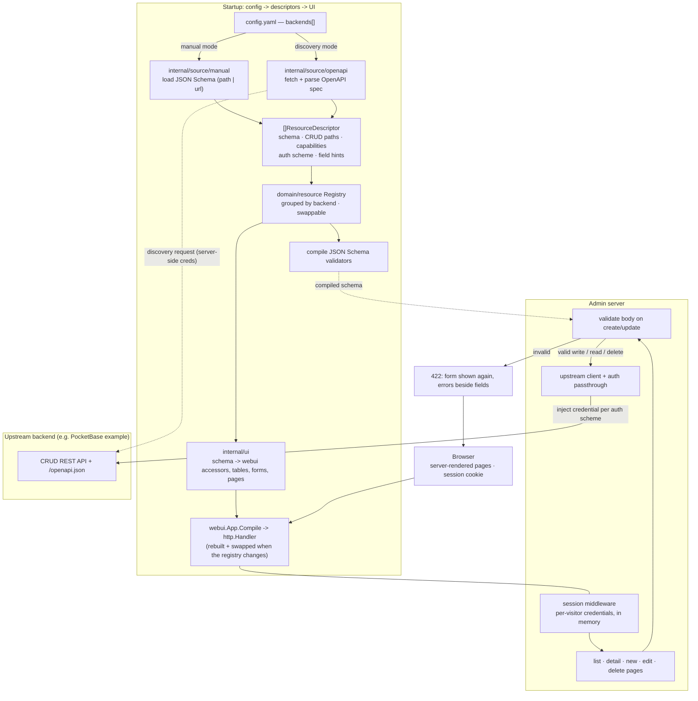

# simple-admin

> **Every backend ends up hand-rolling an admin panel.** simple-admin is one configurable, backend-agnostic admin that any compliant backend can plug into via an OpenAPI spec + CRUD endpoints, with zero frontend code per resource.

A single Go binary that renders CRUD screens for resources hosted by *other* backends, generating the entire UI from the resources' JSON Schemas. The UI is declared in Go with [webui](https://github.com/Olian04/webui) (server-rendered, works without JavaScript, light/dark theme, CSRF + CSP built in). No SPA, no Node toolchain, no HTML/CSS/JS in this repo.

## Architecture & data flow



## Quick start

Bring up the admin UI + the reference PocketBase backend:

```sh
docker compose -f deploy/docker-compose.yml up --build
# admin UI:        http://localhost:8080/ui/
# example backend: http://localhost:8090/openapi.json
```

Or run locally:

```sh
# 1. reference backend (separate module)
cd example-backend && go run . serve --http=127.0.0.1:8090

# 2. admin UI
make run   # APP_CONFIG_FILE=configs/config.example.yaml, or pass --config
```

## Configuration

`APP_CONFIG_FILE` (or `--config`) points at a YAML file — see [`configs/config.example.yaml`](configs/config.example.yaml). Each backend is **manual** (resources listed with their own JSON Schema) or **discovery** (resources derived from an OpenAPI spec):

```yaml
backends:
  - id: example                         # stable id -> sidebar group + URL segment
    base_url: http://localhost:8090
    auth: { type: apikey, in: header, name: X-API-Key }   # scheme only (no secret)
    resources:
      - name: posts
        schema: ./schemas/post.json     # path OR { url: ... }
        paths: { collection: /api/collections/posts/records, item: /api/collections/posts/records/{id} }
        update_verb: PATCH
        field_hints:                    # optional: pick a built-in input for a field
          author: relation              # choose a record of another resource
          rating: { widget: slider, min: 0, max: 5, step: 1 }
          status: { widget: select, options: [draft, { value: live, label: Live, tone: ok }] }
  - id: gateway
    base_url: http://localhost:8090
    discovery:                          # resources + auth scheme derived from the spec
      url: http://localhost:8090/openapi.json
      poll_interval: 5m                 # background poller refreshes resources at this interval
      auth: { type: apikey, in: header, name: X-API-Key, value: ${GATEWAY_DISCOVERY_KEY} }
```

### Compliant backend contract

A backend works with simple-admin if it exposes:

- `GET /openapi.json` — OpenAPI 3 describing resources, component schemas, CRUD paths, and `securitySchemes` (discovery mode).
- CRUD per resource: `GET {collection}` (list — bare array or `{items:[…]}` envelope), `POST {collection}`, `GET {item}`, `PUT`/`PATCH {item}`, `DELETE {item}` where `{item}` = collection + `/{id}`.
- Conventional status codes (404, 4xx) + JSON bodies.

`example-backend/` is a runnable reference built on PocketBase that satisfies this contract.

## Auth

The admin holds **no secrets**. Each visitor gives a backend's key on the **Credentials** page (shown when a backend uses `apikey`). It is typed into a password-style field, kept **in server memory for that browser session** (an opaque `HttpOnly` cookie, 24 h sliding), never written to disk, and passed through to the upstream backend per its auth scheme. `none` + `apikey` are implemented; `bearer`/`basic`/`oauth` are stubbed (config rejects them with a clear error). The auth scheme is declared in YAML for manual backends and derived from `securitySchemes` for discovery backends.

webui does no authentication of its own: run simple-admin behind your own login (reverse proxy, SSO) if the UI itself must be private.

## Inputs

Each schema field becomes a webui accessor, used as a table column and as a form input:

| Schema | Input |
| --- | --- |
| `string` | text (`maxLength`, `required`, and a `pattern` webui can express, enforced in the page and again on the server); long text (`maxLength` > 200, or a name like `body`/`description`) is a text area |
| `string` + `date` / `date-time` | date picker / date-time picker (UTC) |
| `string` + `email` / `uri` / `color` | email, website and color inputs |
| `integer` / `number` | number input (`minimum`, `maximum`); empty means unset and is left out of the request |
| `boolean` | Yes / No / unset choice |
| `enum` | drop-down |
| `array` of scalars | comma separated text |
| `array` / `object` | JSON in a text area |
| a field named like another resource on the same backend (`author`, `author_id` → `authors`) | choice of that resource's records (first 200), shown by label |

`field_hints` override the guess: `relation` (`resource`, `label_field`), `slider` (`min`, `max`, `step`) and `select` (`options`). The full JSON Schema is still the authority: a write it refuses is shown beside the field. Custom `html/template` widgets are gone with the old frontend (webui does not let an app write markup).

Known limits, each tracked as a webui gap in [`docs/webui-gaps.md`](docs/webui-gaps.md): no syntax-highlighted editor inside a form, no tags input, no typeahead for big relation lists. A schema `description` is shown as the field's help. Lists cannot be filtered (the backend contract has no filtering), so the column filters are switched off.

## Development

```sh
make build      # static binary
make lint       # vet, mod verify, govulncheck, golangci-lint
make test       # unit tests (mirror internal/ under test/unit/)
```

See [`.plan/`](.plan/) for the implementation plan, decision log, and per-step progress.

## Layout

| Path | Role |
| --- | --- |
| `cmd/simple-admin` | Entry: config load, slog, signals, `app.Run`. |
| `internal/app` | Composition root: build descriptor sources → registry → UI → wire router; rebuild the UI when discovery refreshes. |
| `internal/config` | YAML config (`backends:` manual/discovery), defaults, validation. |
| `internal/domain/resource` | Canonical model (`ResourceDescriptor`), ports (`Store`/`Validator`/`DescriptorSource`), registry. Pure stdlib. |
| `internal/source/{manual,openapi}` | Produce descriptors from config / OpenAPI specs. |
| `internal/app/poller.go` | Background discovery poller (refreshes the registry on `poll_interval`, then rebuilds the UI). |
| `internal/backend` | Outbound CRUD client + auth passthrough. |
| `internal/schemavalidation` | JSON Schema validation → field-keyed errors. |
| `internal/ui` | The webui declaration built from the registry: accessors per field, list/detail/new/edit/delete pages, credentials page, session store, hot-swappable `Live` handler. |
| `internal/transport/http` | Router: `/healthz`, `GET /` → `/ui/`, the UI under `/ui/`; request counting + logging. |
| `example-backend/` | **Separate module**: PocketBase reference backend + generated OpenAPI. |
| `deploy/` | docker-compose local stack. |
