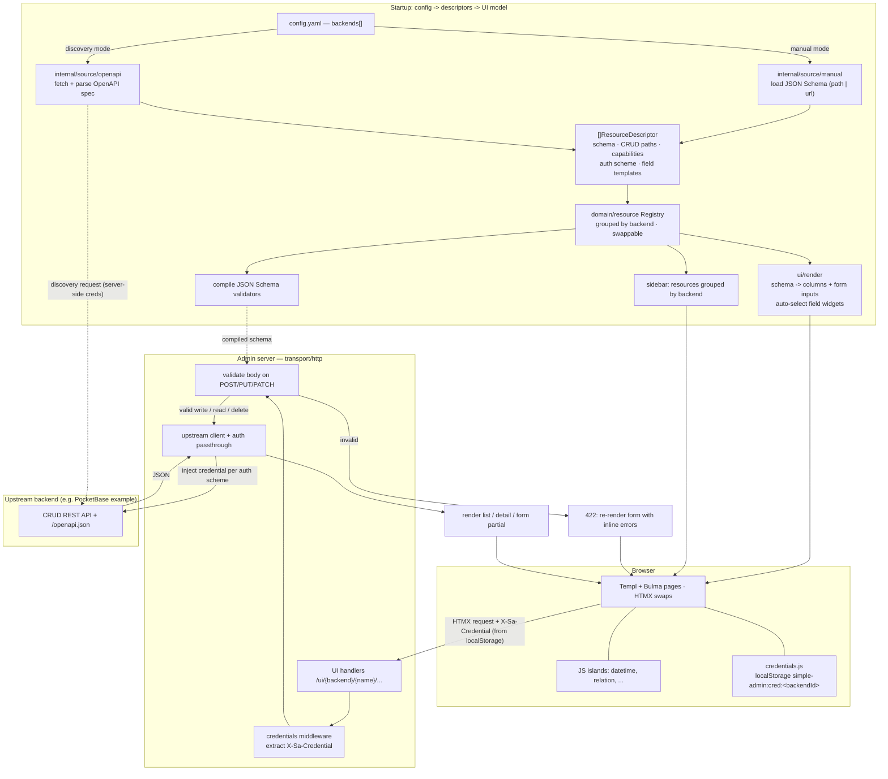

# simple-admin

> **Every backend ends up hand-rolling an admin panel.** simple-admin is one configurable, backend-agnostic admin that any compliant backend can plug into via an OpenAPI spec + CRUD endpoints, with zero frontend code per resource.

A single Go binary that renders CRUD screens for resources hosted by *other* backends, generating the entire UI from the resources' JSON Schemas. Stack: [Templ](https://templ.guide) + [HTMX](https://htmx.org) + [Bulma](https://bulma.io), with small JS islands for rich widgets. No SPA, no Node toolchain.

## Architecture & data flow



## Quick start

Bring up the admin UI + the reference PocketBase backend:

```sh
docker compose -f deploy/docker-compose.yml up --build
# admin UI:        http://localhost:8080/ui
# example backend: http://localhost:8090/openapi.json
```

Or run locally:

```sh
# 1. reference backend (separate module)
cd example-backend && go run . serve --http=127.0.0.1:8090

# 2. admin UI
make run   # APP_CONFIG_FILE=configs/config.example.yaml, or pass --config
```

## Configuration

`APP_CONFIG_FILE` (or `--config`) points at a YAML file — see [`configs/config.example.yaml`](configs/config.example.yaml). Each backend is **manual** (resources listed with their own JSON Schema) or **discovery** (resources derived from an OpenAPI spec):

```yaml
backends:
  - id: example                         # stable id -> sidebar group + browser cred key
    base_url: http://localhost:8090
    auth: { type: apikey, in: header, name: X-API-Key }   # scheme only (no secret)
    resources:
      - name: posts
        schema: ./schemas/post.json     # path OR { url: ... }
        paths: { collection: /api/collections/posts/records, item: /api/collections/posts/records/{id} }
        update_verb: PATCH
        field_templates:
          body: code                    # built-in widget id (shorthand)
          rating: { template: rating, args: { max: { jsonpath: '$.maxRating' } } }
  - id: gateway
    base_url: http://localhost:8090
    discovery:                          # resources + auth scheme derived from the spec
      url: http://localhost:8090/openapi.json
      poll_interval: 5m                 # background poller refreshes resources at this interval
      auth: { type: apikey, in: header, name: X-API-Key, value: ${GATEWAY_DISCOVERY_KEY} }
```

### Compliant backend contract

A backend works with simple-admin if it exposes:

- `GET /openapi.json` — OpenAPI 3 describing resources, component schemas, CRUD paths, and `securitySchemes` (discovery mode).
- CRUD per resource: `GET {collection}` (list — bare array or `{items:[…]}` envelope), `POST {collection}`, `GET {item}`, `PUT`/`PATCH {item}`, `DELETE {item}` where `{item}` = collection + `/{id}`.
- Conventional status codes (404, 4xx) + JSON bodies.

`example-backend/` is a runnable reference built on PocketBase that satisfies this contract.

## Auth

The admin holds **no secrets**. Per-backend credentials live in the **browser's localStorage** (Credentials page in the sidebar), are injected into requests as `X-Sa-Credential`, and the server **passes them through** to the upstream backend per its auth scheme. `none` + `apikey` are implemented; `bearer`/`basic`/`oauth` are stubbed (config rejects them with a clear error). The auth scheme is declared in YAML for manual backends and derived from `securitySchemes` for discovery backends.

## Field widgets

Form fields render via descriptive, library-agnostic widgets (compiled Templ components). Built-ins auto-select by convention (`date-time` → `datetime`; a `{resource}`/`{resource}Id` field referencing another resource on the same backend → `relation` picker), and any field can be overridden in config. Widget args are static or resolved from the record via JSONPath.

Implemented: `datetime`, `relation`, `color`, `json`, `tags`, plus `code` (Monaco) and `markdown` (EasyMDE) which load from the configured `ui.*_cdn`. `geo`, `richtext`, `file`, etc. are registered stubs. Operators can also point a field at a custom `html/template` file.

**Widget data contract:** every widget — built-in Templ or user `html/template` — receives the same `FieldContext`: the field's value + args, its full schema metadata (`Field`), and a queryable view of sibling fields (`Sibling`, `SiblingValue`, `BoolSiblings`, `IDSiblings`, `SiblingsOfKind`) so a widget can react to related fields (flags, foreign keys).

## Development

```sh
make generate   # templ -> *_templ.go (gitignored)
make build      # static binary
make lint       # vet, mod verify, govulncheck, golangci-lint
make test       # unit tests (mirror internal/ under test/unit/)
```

See [`.plan/`](.plan/) for the implementation plan, decision log, and per-step progress.

## Layout

| Path | Role |
| --- | --- |
| `cmd/simple-admin` | Entry: config load, slog, signals, `app.Run`. |
| `internal/app` | Composition root: build descriptor sources → registry → widgets → wire router. |
| `internal/config` | YAML config (`backends:` manual/discovery), defaults, validation. |
| `internal/domain/resource` | Canonical model (`ResourceDescriptor`), ports (`Store`/`Validator`/`DescriptorSource`), registry. Pure stdlib. |
| `internal/source/{manual,openapi}` | Produce descriptors from config / OpenAPI specs. |
| `internal/app/poller.go` | Background discovery poller (refreshes the registry on `poll_interval`). |
| `internal/backend` | Outbound CRUD client + auth passthrough. |
| `internal/schemavalidation` | JSON Schema validation → field-keyed errors. |
| `internal/views` | Templ page components (layout/list/detail/delete/credentials) + display helpers. |
| `internal/views/form` | Form rendering: form Templ, field model, widget registry, args, auto-select, widget components. |
| `internal/transport/http` | Router (`GET /` → `/ui`), handlers, credentials middleware, CSP. |
| `web/` | Embedded static assets (Bulma, HTMX, app.css, JS islands). |
| `example-backend/` | **Separate module**: PocketBase reference backend + generated OpenAPI. |
| `deploy/` | docker-compose local stack. |
